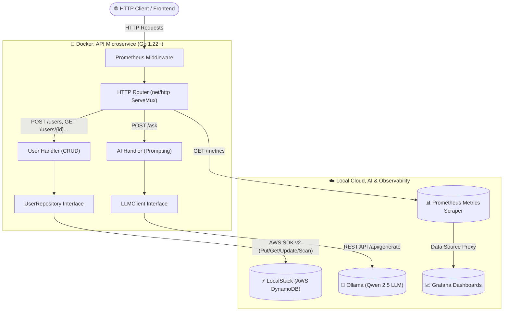

# AWS Cloud-Native Go Microservice

[](https://github.com/jzxq45/aws-cloud-project/actions/workflows/ci.yml)


High-performance, production-ready Cloud-Native Go microservice implementing **Clean Architecture**, local AWS cloud emulation via **LocalStack (DynamoDB)**, on-premise LLM inference with **Ollama**, real-time **Prometheus** observability, and automated **GitHub Actions CI/CD**.

---

## 🏛 System Architecture

The microservice follows strict Clean Architecture principles with decoupled layers (HTTP Handlers $\to$ Business Interfaces $\to$ DynamoDB / AI Clients):



---

## 🛠 Tech Stack

- **Language:** Go 1.22+ (`net/http`, standard library routing, context propagation)
- **Cloud SDK:** AWS SDK for Go v2 (`github.com/aws/aws-sdk-go-v2`)
- **Cloud Emulation:** [LocalStack](https://localstack.cloud/) (AWS DynamoDB, S3)
- **Local AI / LLM:** [Ollama](https://ollama.com/) (Qwen 2.5 3B model)
- **Infrastructure as Code (IaC):** [Terraform](https://www.terraform.io/) (Declarative table provisioning)
- **Observability:** Prometheus Client Golang (`/metrics` endpoint, latency histogram, counter vector)
- **Containerization:** Multi-stage Dockerfile (`alpine:latest`, unprivileged `appuser`, CA certificates)
- **Orchestration:** Docker Compose with healthchecks and persistent storage volumes
- **CI/CD:** GitHub Actions (Unit testing with `-race` detector, Docker image compilation)

---

## ✨ Key Features

- **Clean Architecture & Dependency Injection:** Complete inversion of control. Handlers interact solely with interfaces (`UserRepository`, `LLMClient`, `DynamoDBAPI`), guaranteeing unit testability and maintainability without global state.
- **Auto-generated UUIDs:** Серверная генерация ID (v4) через `github.com/google/uuid` для стандарта REST (клиенту не обязательно передавать `id`), возврат созданного ресурса со статусом `201 Created`.
- **DoS Protection:** Ограничение размера входящих запросов (1 MB) через `http.MaxBytesReader` во всех хэндлерах для защиты от переполнения памяти.
- **Structured Logging:** JSON-логи с использованием стандартного `log/slog` (Go 1.21+) с контекстными атрибутами, уровнями логирования и таймстемпами.
- **High Cardinality Protection:** Использование `r.Pattern` (Go 1.22+) в метриках Prometheus для предотвращения взрыва кардинальности динамическими идентификаторами маршрутов.
- **High Test Coverage (>80%):** Полное покрытие тестами (>80-100% по пакетам), проверка с `-race` детектором гонок и строгий статический анализ `golangci-lint` (0 замечаний).
- **Graceful Shutdown:** Zero-downtime server shutdown listening to OS signals (`SIGINT`, `SIGTERM`) with buffered timeout context.
- **Prometheus Observability & Grafana:** Native middleware capturing request counts, latencies, HTTP methods, and status codes with automated provisioning.
- **Resilient Multi-Stage Docker Build:** Minimal lightweight Alpine runtime image run as a non-root user (`UID 10001`).

---

## 🚀 Quick Start

### 1. Prerequisites
- [Docker Desktop](https://www.docker.com/products/docker-desktop/) (with Docker Compose)
- [Go](https://go.dev/dl/) 1.22+
- [Terraform](https://developer.hashicorp.com/terraform/downloads) (optional for local IaC runs)

### 2. Clone & Setup Environment
```bash
git clone https://github.com/jzxq45/aws-cloud-project.git
cd aws-cloud-project
cp .env.example .env
```

### 3. Launch with Docker Compose
```bash
docker compose up -d --build
```

### 4. Pull the Local LLM Model
Download the high-efficiency `qwen2.5:3b` model into the Ollama container:
```bash
docker compose exec ollama ollama pull qwen2.5:3b
```

---

## 🧪 API Usage & Examples

### 1. Create User (`POST /users`)
*ID is optional; if omitted, a UUID v4 is automatically generated:*
```bash
curl -X POST http://localhost:8080/users \
  -H "Content-Type: application/json" \
  -d '{"name":"Senior Engineer", "email":"senior@cloud.local"}'
```
*Response (`201 Created`):*
```json
{
  "id": "96c3b099-f291-48eb-960a-8469843b21ec",
  "name": "Senior Engineer",
  "email": "senior@cloud.local"
}
```

### 2. Get User By ID (`GET /users/{id}`)
```bash
curl -X GET http://localhost:8080/users/usr-101
```
*Response (`200 OK`):*
```json
{"id":"usr-101","name":"Senior Engineer","email":"senior@cloud.local"}
```

### 3. Update User (`PUT /users/{id}`)
```bash
curl -X PUT http://localhost:8080/users/usr-101 \
  -H "Content-Type: application/json" \
  -d '{"name":"Lead Cloud Architect", "email":"architect@cloud.local"}'
```

### 4. List All Users (`GET /users`)
```bash
curl -X GET http://localhost:8080/users
```

### 5. Delete User (`DELETE /users/{id}`)
```bash
curl -X DELETE http://localhost:8080/users/usr-101
```

### 6. AI Prompt Generation (`POST /ask`)
```bash
curl -X POST http://localhost:8080/ask \
  -H "Content-Type: application/json" \
  -d '{"prompt":"Explain why Go is ideal for cloud-native microservices in one sentence."}'
```
*Response (`200 OK`):*
```json
{"response":"Go's lightweight concurrency, rapid compilation, and minimal memory footprint make it exceptionally well-suited for high-density, low-latency microservices."}
```

### 7. Prometheus Metrics (`GET /metrics`)
```bash
curl -X GET http://localhost:8080/metrics
```

### 8. Grafana Observability Dashboard
- **URL:** [http://localhost:3000](http://localhost:3000)
- **Login:** `admin` / `admin`
- **Preconfigured Dashboard:** *AWS Cloud API Metrics* (`/d/aws-api-metrics/aws-cloud-api-metrics`)
- **Metrics Tracked:**
  - `http_requests_total` (RPS, Endpoint Breakdown, Status Codes)
  - `http_request_duration_seconds` (p95 latency and average latency)

---

## ⚙️ Environment Variables

The application is configured using 12-Factor principles via environment variables:

| Variable | Default Value | Description |
| :--- | :--- | :--- |
| `AWS_ENDPOINT_URL` | `http://localhost:4566` | LocalStack AWS endpoint (internal: `http://localstack:4566`) |
| `AWS_DEFAULT_REGION` | `us-east-1` | AWS region configuration |
| `AWS_ACCESS_KEY_ID` | `test` | Mock access key for LocalStack |
| `AWS_SECRET_ACCESS_KEY` | `test` | Mock secret key for LocalStack |
| `OLLAMA_URL` | `http://localhost:11434` | Ollama LLM host endpoint |
| `LOCALSTACK_AUTH_TOKEN` | *(optional)* | LocalStack authentication token |

---

## 🧪 Testing & Code Quality

Run tests with race detection:
```bash
go test -v -race ./...
```

Inspect coverage by package:
```bash
go test -cover ./...
```

Run static analysis:
```bash
golangci-lint run ./...
```

---

## 📁 Project Structure

```text
.
├── .github/workflows/
│   └── ci.yml               # GitHub Actions CI/CD Pipeline
├── cmd/
│   └── api/
│       ├── main.go          # Composition Root & Graceful Shutdown
│       └── main_test.go     # Integration & HTTP suite tests
├── internal/
│   ├── ai/                  # LLM Client interface & Ollama implementation
│   ├── handler/             # HTTP Handlers (User & AI) + Router
│   ├── middleware/          # Prometheus latency & counter metrics
│   ├── model/               # Domain data structures (User DTO)
│   └── repository/          # Repository contracts & DynamoDB implementation
├── terraform/
│   └── main.tf              # DynamoDB table IaC definition
├── Dockerfile               # Production multi-stage Alpine Dockerfile
├── docker-compose.yml       # Local infrastructure setup
└── README.md
```

---

## 📄 License
This project is open-source software licensed under the [MIT License](LICENSE).
